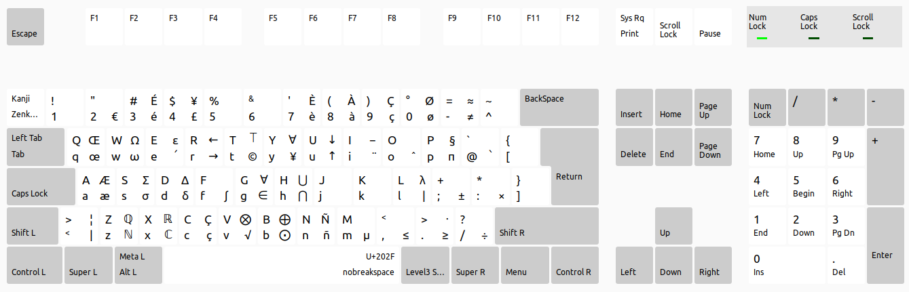

# FrenchOnJPKB

A French/English QWERTY layout for **Japanese JIS keyboards**, with accents, ligatures, Greek letters and mathematical symbols available through AltGr. Designed originally for Ubuntu and scientific writing.



## Important: Japanese space keys

**無変換 (Muhenkan, XKB `<MUHE>`) and 変換 (Henkan, XKB `<HENK>`) both produce Space.** This is intentional: they act as extensions of the short JIS spacebar and should **not** be remapped to AltGr. The カタカナ/ひらがな (Kana) key acts as right Alt (AltGr) in this layout. This means the layout does not preserve Kana's default IME switching role: configure an alternative Japanese input-method shortcut if you need one.

The existing shortcuts and scientific symbols have been preserved; see the `frjp` variant in the `fr` source and the diagram above. Note that actual physical key positions may differ slightly between JIS keyboard models, including the Logicool K295.

## Ubuntu installation

Use an Ubuntu desktop configured for a Japanese 106/109 keyboard. A terminal and administrator access are required. The installer **adds only the `frjp` variant** to the installed XKB files instead of overwriting the distro's entire `fr` and `evdev.xml` files.

```bash
sudo apt update
sudo apt install git python3 libxkbcommon-tools
git clone https://github.com/caillotantoine/FrenchOnJPKB.git
cd FrenchOnJPKB
sudo python3 install.py install
python3 install.py check
xkbcli compile-keymap --layout fr --variant frjp >/dev/null
```

Log out and log in again; open **Settings → Keyboard → Input Sources**, add the **French (JP, JIS keyboard)** variant, then select it. Depending on GNOME's language filtering, use the input-source dialog's additional languages / other layouts.

On GNOME Wayland, changing the XKB layout using `setxkbmap` is **not** a reliable way to select a system-wide input source. Choose the layout in GNOME Settings instead.

### Reverting

Select a different input source first, then:

```bash
sudo python3 install.py uninstall
```

The installer creates `.frenchonjp.bak` snapshots alongside the two modified system files before writing. It does not overwrite those backups on subsequent runs. On an **older installation** created by copying the entire repository's `fr` file, restore the distribution files first or reinstall `xkb-data` before using this installer. The uninstall command removes the managed variant and registration; it cannot safely reconstruct every change made by an old manual install.

**Updates:** The installer still edits system-managed XKB files (rather than claiming to use a universal per-user mechanism). An `xkb-data` package upgrade may overwrite these additions; simply rerun `sudo python3 install.py install` after upgrading. Never copy this repository's full `evdev.xml` or `fr` over current distro files: these files are distro-version-specific.

## How to check physical keys

Modern evdev keymaps use `<MUHE>` and `<HENK>` for these keys. The older `<NFER>` and `<XFER>` names are not the right mapping for modern Ubuntu. If updating an existing installation, pull the latest files and rerun `sudo python3 install.py install`, then log out and back in.\n\nOn Wayland, install `libinput-tools`, then run `sudo libinput debug-events --show-keycodes` to confirm key events while pressing Muhenkan, Henkan and Kana. On X11, `xev` may be useful instead. These physical keys should be tested on the actual keyboard before adjusting the mapping.

## Legacy

The `fr` and `evdev.xml` files are retained for reference and backward compatibility. Do **not** follow the old installation method of replacing both files wholesale. Earlier documentation recommended `input-remapper` to turn Henkan into right Alt; **that would defeat the short-spacebar workaround**, so it is not recommended for this layout.

Pull requests and keyboard-model test results are welcome.
